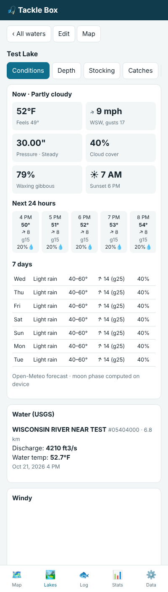

# Tackle Box: a private fishing app

A Fish Deeper–style app that keeps all of your data on your own device. No account, no server, no analytics.

## What it does (MVP)

| Area | What you get | Data source |
|---|---|---|
| Map | Satellite/street map, your lakes, every catch pinned, depth maps overlaid | OpenStreetMap / Esri tiles |
| Conditions | Now, next 24 h, 7 days: temp, wind speed/direction/gusts, pressure + trend, clouds, rain chance, sunrise/sunset, moon phase | Open-Meteo (free, no key), moon computed locally |
| Water | Flow, gauge height and water temp from the nearest USGS gauges | USGS Water Services (free, no key) |
| Windy | Live Windy wind map embedded on each lake, plus a link that opens Windy with your Premium login | Windy embed |
| Depth charts | Import your Deeper soundings (CSV, GPX, KML) and see them as a colored depth map | Your own exports |
| Stocking | Stocking history per lake, totals by year, CSV import, link to the state report | You / state DNR downloads |
| Lake info | Acres, max depth, clarity, species, regulations, access, DNR links | You / state DNR pages |
| Catch log | Species, length, weight, depth, water temp, lure, technique, photo, GPS spot, released. Weather, wind, pressure trend and moon are captured automatically | Device |
| Notes | Per-lake notes, optionally pinned to a spot | Device |
| Stats | By species, lake, lure, hour, pressure trend, moon phase, depth band | Device |
| Backup | Export/import one JSON file (photos included), optionally password-encrypted, to move devices or keep a copy | Device |

It is a PWA: open it once in Safari/Chrome, choose **Add to Home Screen**, and it behaves like an app and opens with no signal (map tiles you've already viewed are cached).

## Conditions and forecasting

* **Bite windows:** solunar major periods (2 h around moon overhead and underfoot) and minor periods (1 h around moonrise and moonset), computed on the device, rated 0–4 stars by moon phase and overlap with sunrise/sunset. Marked on the 24-hour strip and listed for each of the 10 days.
* **Weather alerts:** National Weather Service alerts in effect at the water show as a banner on Conditions.
* **Rain radar:** map layer *Rain radar* (RainViewer, last 2 hours, play or scrub). RainViewer's free tiles stop at zoom 7, so it is blocky up close.
* **Wind on the water:** which bank the wind is blowing into, with the next big shift; map layer *Wind on my lakes* puts a wind arrow on each saved water.
* **Flow vs normal:** for USGS stream gauges, today's flow as a percent of the median for this date over the gauge's record, with a fishable / high / blown-out read on rivers.
* **Today (home screen):** your starred waters at a glance: weather, wind and which bank it's blowing into, the next bite window, 7-day level change, and new or upcoming CDFW plants, with NWS alerts flagged. Star a water with ☆ on its page.
* **Plan a trip:** pick a day in the next 10 and your saved waters are ranked 0–10 by wind, rain, temperature, pressure trend, solunar rating, days since the last plant and lake-level trend, with the reasons and the best time to be on the water.

## Logging and journal

* **Trip mode** (Journal → Start a trip, or the Log view): records your GPS track while the app is open, with big one-tap **Catch / Bite / Lost** buttons and a species picker built from your recent catches. Each tap is stamped with the time and your spot; add a length and photo right away or later. iPhones stop location updates when the screen locks, so trip mode keeps the screen on by default. The end-of-trip page shows time on the water, fish per hour, bites and lost fish, distance, and the track with every catch on a map.
* **Journal**: a rating, who you fished with, a write-up and photos for each trip, or for a past day without trip mode. The timeline lists trips, catches and notes newest first.
* **Personal bests and life list**: every species you've caught, when and where first, longest and heaviest, overall and per water. A blank weight is estimated from length with standard-weight formulas for the species (shown with ≈).
* **Tackle box**: your lures and baits with photos; pick one on the catch form and see how many fish each has caught.
* **From photos**: pick old fish photos and Tackle Box reads the date and GPS on the device, matches the water (yours or any California water), and makes draft catches to confirm.
* **Units**: inches or cm, pounds or kg, feet or meters (Data view). Records are stored in inches, pounds and feet.

## Water data and safety

* **Regs & safety tab** on every water: special regulations that name the water (Title 14 §7.50 trout, §7.40 salmon/steelhead, §5.00 black bass, §5.15 catfish, plus county-wide rules), matched by name, kind of water and county, with 🟢/🔴 for open or closed today; the statewide rules for the species; current toxic algae advisories; and OEHHA advice on how often you can eat each fish. The CDFW booklet and posted signs are still the final word.
* **Toxic algae banner** at the top of a water's page when the Water Boards have a Caution, Warning or Danger advisory on it, and a *Toxic algae advisories* map layer (on by default).
* **Access & facilities** on the Info tab: boat ramps, fishing piers, parking near them, campgrounds, marinas, boat rentals and bait & tackle from OpenStreetMap, with distance and directions; map layer *Ramps & access* when zoomed in.
* **Plant calendars:** each stocked water has a calendar feed (`data/ca/ics/<stockId>.ics`); *Subscribe to plants* on the Stocking tab adds it to Apple or Google Calendar, with no server knowing who subscribed.
* **New since last visit:** the lake list badges saved waters with CDFW plants added since you last opened their Stocking tab.
* **Catch form warnings:** as you log a catch, a *Check the regs* box above Save flags a closed season, catch-and-release-only rules, wild fish that must go back, size minimums and the daily bag limit (counting what you've kept there that day). It never blocks saving. `CA.regsFor(lake)` and `CA.catchWarnings(lake, catch)` are the API behind it.

## Insights, privacy and sharing

* **Days like today** (Stats, and the Today screen): every catch is scored by how much its day resembles today (date in the season, pressure trend, air temp, wind, moon, time of day, same water), and the card says which species, lures, depths, hours and waters produced on the most similar days. Computed on the device.
* **Stats**: catch rate (fish per hour) from trips, by water and by hour of day; catches by lure color and water clarity (a new optional field on the catch form), with the best color for each clarity; and a **Year in review** page.
* **App lock** (Data view): a 4–8 digit passcode, plus Face ID / Touch ID / fingerprint through the phone's own authenticator (WebAuthn, no server). Locks on open and after a chosen time in the background. It guards the screens; files that leave the phone should use the encrypted backup.
* **Encrypted backup**: the whole backup locked with a password (AES-256-GCM, key from PBKDF2-SHA256 with 600,000 rounds), saved through the share sheet (Save to Files → iCloud Drive, or Drive) or a folder you pick on a computer. Optional reminder when the last backup is older than a week, two weeks or a month. Plain JSON backups still import as before.
* **Crew sharing**: pick catches or a spot and send them as a file (AirDrop, Messages, email) or a QR code, optionally protected by a passphrase. The QR code holds the whole share in the link's `#` fragment, which browsers never send to the website. Shared photos are redrawn so camera and GPS data are gone, and catches leave out the exact spot unless you tick it. Friends' catches go to a separate Crew list (the water's **Crew** tab and the *Crew* map layer), never into your own stats.
* **License and report cards**: store your CDFW license and report-card dates; the app reminds you 30 days ahead and can make a calendar file with alerts.

## California

* **Find stocked waters**: Lakes → *Find California stocked waters* lists every CDFW-stocked lake and river, filtered to recent and upcoming plants, with one-tap *Add*. The map also has a *CA stocked waters* layer (green = planted in the last 30 days).
* **Stocking per lake**: the Stocking tab shows CDFW plants for that water (upcoming plants, last plant, plants per year, full list). CDFW publishes week and species but not fish counts.
* **History**: CDFW's public schedule only goes back about a year, so the nightly job merges each day into `data/ca/plants.json`. History builds from 2025-10 onward.
* **Lake level**: for reservoirs, Conditions shows CDEC elevation, 7- and 30-day change, and storage. The nearest gauge within 25 km is used; set a station id under Edit if it picks the wrong one.

Data is refreshed daily by `.github/workflows/update-data.yml` running `scripts/update-ca-data.mjs`. It runs on GitHub because the state sites don't let a browser app fetch from them directly. It is all public data, and the job never sees anything from your phone.

**Nevada and Oregon (planned)**: same shape, as `states/nv.js` and `states/or.js` plus a nightly script each. The sources are NDOW's weekly stocking reports and ODFW's trout stocking schedule and past stocking reports. Nevada reservoir levels come from USBR and USGS. Oregon lake levels come from USGS and the Army Corps of Engineers.

## Every California lake and river

* **Labels on the map** for every named lake, reservoir and river in California (zoom in for the small ones). Tap a label or the water itself to open it.
* **Tap any water** for current weather and a 10-day forecast, CDFW stocking and upcoming plants, lake level, depth, history and basic facts (size, elevation), all before you save it. *Save to my lakes* adds it to your list for catches and notes.
* **Lakes → Any California water** searches the whole list by name.
* **Depth:** max and average depth where a published survey exists, and full depth-contour charts for lakes USGS has surveyed (Calaveras, San Antonio, Whiskeytown and more as they appear), drawn as depth at today's level when the lake has a CDEC gauge.
* **History tab:** introductions and plantings recorded at that water, back to the 1870s, plus a statewide timeline of how California's waters were stocked.

### Where the statewide data comes from

| Data | Source | Refresh |
|---|---|---|
| Lake and river names, size, elevation | USGS National Hydrography Dataset | weekly |
| Max and mean depth | LAGOS-US DEPTH (published lake depth surveys), Wikidata for lakes it misses | weekly |
| Estimated average depth, volume, shoreline | HydroLAKES (modelled from lake shape and terrain, every lake over 25 acres) | monthly |
| Depth contour charts | USGS ScienceBase bathymetric surveys | monthly |
| Historical introductions and plantings | USGS Nonindigenous Aquatic Species database, plus documented early events (Fish Bulletin 178) | weekly |
| Current plants and stocking history | CDFW planting schedule | nightly |
| Lake levels | CDEC | nightly |
| Toxic algae advisories | California Water Boards FHAB bloom reports (data.ca.gov) | nightly |
| Plant calendar feeds | built from the CDFW planting schedule | nightly |
| Fishing regulations | California Code of Regulations Title 14 (Cornell LII), county lines from US Census TIGERweb | weekly |
| Fish consumption advisories | OEHHA (data.ca.gov) | weekly |
| Ramps, piers, parking, campgrounds, marinas, tackle shops | OpenStreetMap via Overpass | monthly |

### What the records can and can't tell you

* CDFW's digital planting records begin in the 2000s, and the public schedule shows about a year; the app keeps every day it sees, so history grows from October 2025 forward.
* Before that, the record is species introductions: the state Fish Commission (founded 1870), the U.S. Fish Commission and private parties moved shad, carp, bass, catfish, brown and brook trout into California waters from 1871 on. Those events, where they were recorded, show on the History tab.
* Native fish planted inside their native range, such as most rainbow trout plants in Sierra streams, were rarely logged by water before the 1930s and are not in any public database. Miners and settlers did carry trout into fishless high-country lakes from the 1870s; the golden trout transplant of 1876 is the best documented.

## Maps, depth and offline

* **Save a lake for offline**: open a water → *⬇ Offline*. It downloads the satellite map for the lake's area (zoom 10–17, capped at about 6,000 tiles with a size estimate first), its USGS depth chart and the California data the lake page uses. Saved lakes are listed under Data → *Offline maps*, where you can delete them. The street map isn't downloaded in advance because OpenStreetMap's tile policy doesn't allow offline prefetching; street areas you've already viewed stay cached.
* **Contour map from your Deeper scans**: Depth tab → *Contour map*. Every scan of the lake is merged on the phone into one grid (inverse-distance weighting over nearby soundings; areas you haven't scanned stay blank), traced into labeled contour lines with optional shading. On import the app asks for the scan date (read from the file when it has timestamps) and fills in that day's lake level from CDEC when the gauge has it, so scans taken at different water levels line up; the map is drawn at today's level.
* **Water temperature**: Depth tab → *Water temperature*. Surface temperature by date from Deeper scans that carry a temperature column (a Deeper floats, so it measures the surface) and from catches, a map of each scan's surface temperature, and temperature-by-depth profiles you enter from a drop thermometer, with the thermocline marked.
* **Catch heatmap**: map layers → *Catch heatmap*, filtered by species and season.
* **Waypoints**: long-press the map, or tap *📌 Mark* and use GPS or a tap, to mark a spot, structure, brush pile, drop-off, hazard or ramp with a name and note. They show as a *Waypoints* map layer, are listed on the lake's Depth tab, export as GPX, and go with a shared lake only if you include your notes and spots.

## Sharing with friends

* Everyone installs the same link. Each person's catches, notes and spots stay on their own phone. There are no shared accounts.
* **Share a lake**: open a lake → *Share*. It sends a small file through Messages, AirDrop, email and so on, containing the lake, your Deeper depth maps and (if you choose) your notes, pinned spots and waypoints. Catches are never included. Your friend opens the app → Data → *Import backup or shared lake*.

## Installing on iPhone and Android

* **iPhone**: open the link in Safari → Share → *Add to Home Screen*.
* **Android**: open the link in Chrome → ⋮ → *Install app*.

The Data tab shows the right steps for the phone you're on.

## Privacy model

* Catches, notes, photos, spots, depth data and stocking records live only in the browser's IndexedDB on your phone.
* The only outbound calls are: lake coordinates to Open-Meteo and USGS for conditions, map tile requests, and Windy when you open that panel. None carry your catch data.
* Because nothing is stored server-side, the app can be hosted anywhere static (even public GitHub Pages) without exposing data. Back up regularly: if you clear the browser's site data, the data goes with it.

## Running it

GPS and "Add to Home Screen" need HTTPS. Options, simplest first:

1. **GitHub Pages** (private repo + Pages, or public repo; data still stays on the phone).
2. **Your own machine**: `python3 -m http.server 8080` in this folder for desktop use; use Tailscale (`tailscale serve 8080`) to reach it from your phone over HTTPS.
3. Any static host (Netlify, Cloudflare Pages, a NAS).

No build step: it is plain HTML/JS with Leaflet vendored in `vendor/`.

## Getting your Deeper data in

In Fish Deeper, open Lakebook, pick the scan, and export (on the web at maps.fishdeeper.com, or share/export from the phone app). Import the CSV under **Lakes → your lake → Depth**. The importer looks for latitude, longitude and depth columns by name and converts meters to feet if the column or the units picker says meters. GPX/KML with depth or elevation per point also works.

Reverse-engineering other apps isn't needed: the public sources above cover conditions, and your own Deeper exports are the best depth data you can have for the water you fish.

## Windy and MyRadar

* **Windy**: your Premium subscription unlocks features on windy.com and in their app, but it is not an API key. The app embeds Windy's free map widget per lake and deep-links to windy.com where your Premium login applies. If you want Windy numbers *inside* the app (e.g. their ECMWF point forecast in the catch snapshot), that needs a separate Windy Point Forecast API key, which Windy sells separately. That would be a small addition (a key field in settings, stored only on the device).
* **MyRadar**: no public API for subscribers, so the app links out to it. Radar inside the app could come from free sources (NOAA/NWS radar or RainViewer tiles) if you want it.

## Next steps

* Nevada and Oregon stocking and lake levels (see above).
* Depth contour lines (not just colored points) and spot waypoints with icons.
* Water-temp/thermocline log from Deeper readings.
* Optional encrypted sync between your own devices (e.g. to a folder you control) if you want phone + desktop.

## Files

* `index.html`, `styles.css`: UI
* `app.js`: views, map, catch log, stats
* `db.js`: IndexedDB storage and backup
* `data-sources.js`: Open-Meteo, USGS, moon phase, CSV/GPX/KML parsers
* `states/ca.js`: California stocking, reservoir, statewide water, depth-survey and history lookups
* `scripts/update-ca-data.mjs`: nightly CDFW plants, stocked waters and CDEC levels → `data/ca/`
* `scripts/build-ca-waters.mjs`, `build-ca-history.mjs`: weekly statewide water list and history
* `scripts/build-ca-bathymetry.mjs`: monthly depth contours → `data/ca/bathymetry/`
* `scripts/build-ca-hab.mjs`, `build-ca-ics.mjs`: nightly algae advisories → `data/ca/hab.json`, plant calendars → `data/ca/ics/`
* `scripts/build-ca-regs.mjs`, `build-ca-oehha.mjs`, `build-ca-access.mjs`: weekly regulations and county lines, fish advisories; monthly access → `data/ca/`
* `data/ca/logs/`: output of each data job, committed so problems can be read from the repo
* `sw.js`, `manifest.json`: offline + install
